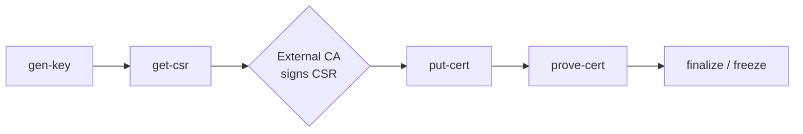

[Click here](../README.md) to view the README.

## Design and implementation

This code example implements a reusable, on-device **provisioning framework** for the PSOC&trade; Control C3 MCU. It provides the building blocks needed to inject and protect per-device cryptographic assets:

- on-device **key-pair generation** with the private key sealed in the secure world,
- **CSR generation** so the public key can be certified by an external CA,
- **certificate / asset import** with transfer-integrity checking,
- a CRC-protected **secure-flash asset store** with an irreversible **freeze**, and
- a **DFU command transport** and a **TrustZone&reg;** secure boundary tying it together.

The framework is intentionally **asset- and use-case-agnostic**. A deployment chooses the crypto suite, the asset-store layout (how many slots and their sizes), and which commands it uses. The version in this repository ships with one concrete configuration as a worked example (see [Example deployment and walkthrough](#example-deployment-and-walkthrough)), but the same firmware can be re-tailored without touching the core modules.

The application uses a two-project structure for the CM33 core. TrustZone&reg; splits the core into a Secure Processing Environment (SPE) and a Non-secure Processing Environment (NSPE):

**Table 1. Application projects**

Project        | Description
-------        | -----------------------
*proj_cm33_s*  | CM33 Secure Processing Environment (SPE). Hosts the provisioning service, on-device PSA crypto / CSR generation, and the Provisioning Asset Store (PAS). Owns all secrets and all flash mutation.
*proj_cm33_ns* | CM33 Non-secure Processing Environment (NSPE). Hosts the DFU middleware (I2C transport) and the provisioning command router. Holds no secrets.

At device reset the ROM boot acts as the Root of Trust and launches the secure project, which applies the device security configuration and then starts the non-secure project. The non-secure project initializes the platform and enters the DFU command loop. A host tool (the companion *psc3-provisioning-host* Python CLI) drives every step over I2C.

The secure/non-secure memory split is established differently per device: on **PSC3M5** the secure project hand-configures SAU + PPC in firmware (gated on `DEVICE_PSC3M5`) and relies on an OEM provisioning policy to program the MPC split; on **PSC3M6** and **PSC3M8** the SAU/MPC/PPC map is owned by the Device Configurator (*design.modus* → generated *cymem_\*.ld* / *partition_psc3.h*) and applied inside `cybsp_init()`, so no provisioning is required to run the secure + non-secure application. (PSC3M8 is a multicore part, but only its main CM33 TrustZone core is used here, so it is treated exactly like PSC3M6.)

```
PC host CLI ──I2C (DFU)──► NS-App (DFU MW + router) ──NSC──► S-App (secure service + crypto) ──► PAS (secure flash)
```


## Project structure and modules

The firmware is layered so that all secret material and all flash mutation stay inside the secure world; the non-secure world only frames the transport and forwards requests across the NSC boundary.

**Table 2. Secure project (`proj_cm33_s`) modules**

Module                    | Location                       | Role
:------------------------ | :----------------------------- | :---
Provisioning service      | *core/prov_svc.c/.h*           | Top-level secure handler for each provisioning operation (key generation, public-key read, CSR build, certificate write/commit/read, prove, status, finalize).
On-device crypto          | *core/prov_crypto.c/.h*, *core/key_slot.h* | Key generation, HUK-derived AES wrap/unwrap of the private key, hashing, and signing. ECDSA (P-256/P-384/P-521) goes through PSA Crypto / mbedTLS; ML-DSA-87 (PSC3M6/PSC3M8) goes through wolfCrypt.
CSR builder               | *core/prov_csr.c/.h*           | Builds a PKCS#10 DER CSR on demand from a key slot; subject DN assembled from a host TLV template. ECDSA CSRs use mbedTLS; ML-DSA-87 CSRs are hand-assembled DER signed with pure FIPS 204 (empty context).
Non-Secure-Callable layer | *nsc/prov_nsc.c*               | `cmse_nonsecure_entry` veneers that validate every non-secure pointer before entering the secure service.
Provisioning Asset Store  | *pas/pas.c/.h*                 | Generic row-aligned, CRC-protected flash slot store with an atomic freeze record.
PAS deployment config     | *pas/pas_config.h*             | Region placement and per-slot sizing for the specific deployment (override this file to re-tailor).
Heap guard (platform)     | *platform/heap_guard.c*        | Bounded `_sbrk` that confines the secure heap to its linker region so a large allocation (e.g. ML-DSA-87 keygen) fails with `ENOMEM` instead of corrupting adjacent memory.
Crypto/PSA config         | *config/*                      | PSA Crypto build configuration (enabled algorithms).

**Table 3. Non-secure project (`proj_cm33_ns`) modules**

Module            | Location                  | Role
:---------------- | :------------------------ | :---
Command router    | *router/prov_router.c/.h* | Decodes the DFU custom-command payload, performs offset-based chunking, and calls the matching NSC veneer. Owns the DFU service loop.
DFU user hooks    | *dfu_user.c*              | DFU middleware configuration, NVM/address callbacks, and the I2C transport glue.
Application entry  | *main.c*                  | Board / DFU / transport bring-up, then hands control to the router.
Logging           | *log/*                    | Lightweight UART logging facility.
Self-test (opt)   | *test/*                   | Build-time self-test that exercises every NSC service at startup (excluded unless enabled).

The secure/non-secure contract (opcodes, status codes, capability structures, and the NSC function prototypes) lives in the shared header *shared/prov_nsc.h*. The non-secure project links against the veneer object (`../build/nsc_veneer.o`) generated by the secure project.


## Capabilities

### Key generation

- **On-device generation.** The key pair is generated inside the secure world using the PSA Crypto API; the private key never leaves the SPE in the clear.
- **Algorithm agility.** Each crypto suite is identified by a 2-byte `alg_id`. The advertised suites and their key/signature sizes are reported by the `info` command so the host never hard-codes lengths. Which suites are compiled in is chosen at build time with `PROV_SIG_SUITES` (see [Build-time configuration](#build-time-configuration)); `PROV_GET_INFO` advertises exactly the enabled set. The following suites are implemented:

   Suite                    | `alg_id` | Public key | Signature | Hash | Availability
   :----------------------- | :------- | :--------- | :-------- | :--- | :-----------
   ECDSA secp256r1 (P-256)  | `0x0001` | 64 B (raw X\|\|Y) | 64 B (raw r\|\|s) | SHA-256 | PSC3M5, PSC3M6 and PSC3M8
   ECDSA secp384r1 (P-384)  | `0x0002` | 96 B (raw X\|\|Y) | 96 B (raw r\|\|s) | SHA-384 | PSC3M5, PSC3M6 and PSC3M8
   ECDSA secp521r1 (P-521)  | `0x0003` | 132 B (raw X\|\|Y) | 132 B (raw r\|\|s) | SHA-512 | PSC3M5, PSC3M6 and PSC3M8
   ML-DSA-87 (FIPS 204 PQC) | `0x0103` | 2592 B | 4627 B | SHA-256 | **PSC3M6 and PSC3M8**

   All three ECDSA curves use PSA Crypto / mbedTLS, each paired with its SHA-2 digest (P-256/SHA-256, P-384/SHA-384, P-521/SHA-512); on every PSC3 part (M5/M6/M8) the MXCRYPTOLITE accelerator covers P-256 and P-384 while P-521 falls back to software mbedTLS (the CryptoLite ECDSA engine tops out at P-384). ML-DSA-87 uses wolfCrypt and is a post-quantum (PQC) suite, gated to **PSC3M6 and PSC3M8** because its key generation and larger working set exceed the PSC3M5 secure-partition budget.

- **Sealed storage.** A key slot stores the raw public key plus the private key **AES-wrapped with a HUK-derived key**, so the private scalar is never stored or exported in plaintext.

### CSR generation

- **PKCS#10, built on demand.** The CSR is generated in transient secure RAM when requested and is **never stored in flash** — it is rebuilt on the next request. It is signed inside the secure world using the slot's wrapped key: the ECDSA suites present the key to mbedTLS as an opaque PSA key signed with the curve-paired digest (`ecdsa-with-SHA256/384/512`); the ML-DSA-87 suite hand-builds the DER `CertificationRequest` and signs the proof-of-possession with wolfCrypt using **pure FIPS 204 signing with an empty context**, so the signature is interoperable with standard verifiers (OpenSSL / `cryptography`).
- **Host-controlled subject DN.** The subject Distinguished Name is supplied by the host as a compact TLV blob (`field_id (1) | length (1) | UTF-8 value`), so the host controls the DN without doing DER itself:

   `field_id` | DN attribute
   :--------- | :-----------
   `0x01`     | commonName (CN)
   `0x02`     | organizationName (O)
   `0x03`     | organizationalUnitName (OU)
   `0x04`     | countryName (C)
   `0x05`     | serialNumber

   If no template is supplied, the subject defaults to `CN = hex(device UID)`.
- **Output.** A DER-encoded `CertificationRequest` containing the subject, the device public key, and a proof-of-possession signature. Certificate issuance from the CSR is performed by an external CA and is out of scope for the device firmware.

### Provisioning Asset Store (PAS)

The PAS is a generic, row-aligned, CRC-protected slot store in secure flash. Its capabilities:

- **Configurable geometry.** The region base address, total size, and per-slot row counts are set at build time in *pas/pas_config.h* (`PAS_BASE_ADDR`, `PAS_REGION_ROWS`, `PAS_SLOT_ROWS_INIT`). The number of slots is derived from the slot-row array.
- **Integrity-protected slots.** Each slot carries a header and is validated by CRC; a slot's *role* (free / key / certificate) is derived live from its validity predicate and stored magic — no separate mutable "state" value is trusted.
- **Role assignment by command.** A slot is generic until a command gives it a role: it becomes a key slot on key generation, or a certificate slot on certificate commit.
- **Asset binding.** A certificate slot records an `assoc_slot` linking it to the key slot it certifies, so the key&harr;certificate binding can be proven on-device.
- **Irreversible freeze.** An isolated freeze-record row makes "provisioned" an atomic, one-way state. After freeze, all mutating commands are rejected; read-back is still allowed.
- **Rework before freeze.** Individual slots (or all slots) can be erased to roll back, but only while the store is not yet frozen.


## How it works

### Transport — DFU custom command over I2C

The provisioning protocol is carried as a DFU **user-defined (custom) command** over I2C. The non-secure router is registered as the DFU custom-command handler, so the DFU command ID *is* the provisioning opcode. `main.c` brings up an SCB I2C block as an I2C slave (driven through the HAL, `mtb_hal_i2c_t`) as the DFU transport, initializes the DFU middleware, and then runs the router's service loop, which re-arms the DFU session after each command and toggles a heartbeat LED while idle.

### Command set

Opcodes live in the DFU user range and are grouped by high nibble: `0x5X` general, `0x6X` key, `0x7X` certificate/CSR.

**Table 4. Provisioning commands**

Opcode  | Name               | Host tool command | Summary
:------ | :----------------- | :---------------- | :------
`0x50`  | `PROV_GET_STATUS`  | `status`      | Report `provisioned` flag, slot count, PAS version, and per-slot role.
`0x51`  | `PROV_GET_INFO`    | `info`        | Report device UID, slot count/sizes, advertised `alg_id` suites (with key/sig sizes), and `max_chunk`.
`0x52`  | `PROV_ERASE`       | `erase`       | Erase one slot (or all) back to free. Requires a confirm constant; rejected when frozen.
`0x53`  | `PROV_FINALIZE`    | `finalize`    | Run a structural check and write the freeze record (irreversible). Requires a confirm constant.
`0x60`  | `PROV_GEN_KEY`     | `gen-key`     | Generate a key pair (per `alg_id`) into a slot.
`0x61`  | `PROV_READ_PUBKEY` | `read-pubkey` | Chunked read-back of a key slot's raw public key.
`0x70`  | `PROV_GET_CSR`     | `get-csr`     | Build a CSR on demand (subject template on the first chunk) and stream it back.
`0x71`  | `PROV_CERT_WRITE`  | `put-cert`    | Chunked certificate write; auto-commits on the final chunk after a transfer-hash check.
`0x72`  | `PROV_READ_CERT`   | `get-cert`    | Chunked read-back of a stored certificate.
`0x73`  | `PROV_PROVE_CERT`  | `prove-cert`  | Return `SHA256(cert)` plus a signature over `nonce‖hash` using the bound key (streamed in chunks), proving key&harr;cert binding.

The first response byte of every command is a result code. The full result-code list, the DFU packet framing and checksum, the session model, the offset-based chunking used for blobs larger than one packet (public key, CSR, certificate), and the per-field layout of every command are specified in [Packet formats](packet_formats.md).

### Secure boundary — NSC veneers

Every cross-domain call goes through a `cmse_nonsecure_entry` veneer in *nsc/prov_nsc.c*. Each veneer validates every caller-supplied pointer with `cmse_check_address_range()` before use, so a malicious non-secure caller cannot reach secure memory. Because a veneer can only take arguments that fit in registers r0–r3, commands that need more inputs/outputs pass a single pointer to an argument block in non-secure memory (the veneer validates the block and every embedded buffer pointer).

**Table 5. NSC veneers** (declared in *shared/prov_nsc.h*)

Veneer                  | Opcode | Purpose
:---------------------- | :----- | :------
`prov_nsc_get_status`   | `0x50` | Status snapshot
`prov_nsc_get_info`     | `0x51` | Device UID / geometry / capability report
`prov_nsc_erase`        | `0x52` | Erase a slot / all slots (confirm-guarded)
`prov_nsc_finalize`     | `0x53` | Freeze the store (confirm-guarded)
`prov_nsc_gen_key`      | `0x60` | Generate a key pair into a slot
`prov_nsc_read_pubkey`  | `0x61` | Chunked public-key read-back
`prov_nsc_build_csr`    | `0x70` | Build the whole CSR into the caller's non-secure buffer (one call, on the first `GET_CSR` chunk; later chunks are streamed by the router with no secure call)
`prov_nsc_cert_commit`  | `0x71` | Commit a fully received certificate
`prov_nsc_read_cert`    | `0x72` | Chunked certificate read-back
`prov_nsc_prove_cert`   | `0x73` | Sign `nonce‖SHA256(cert)` into the caller's non-secure buffer (one call, on the first `PROV_PROVE_CERT` chunk; later chunks stream the signature with no secure call)


## Resources and settings

**Table 6. Application resources**

Resource    | Alias/object   | Purpose
:---------- | :------------- | :------------
I2C (HAL)   | dfuI2cHalObj   | I2C transport used by the DFU middleware to receive provisioning commands and return responses
UART (HAL)  | (retarget-io)  | Retargets standard I/O to the kit debugger UART (KitProg3 on M5, J-Link virtual COM on M6) for log output

The application uses the [retarget-io](https://github.com/Infineon/retarget-io) library to route log messages to the UART, and Infineon's [DFU](https://github.com/Infineon/dfu) middleware to manage the I2C command transport.

### Build-time configuration

Setting                                   | Where                          | Purpose
:---------------------------------------- | :----------------------------- | :------
`SECURE_SRAM_SIZE` / `SECURE_FLASH_SIZE`  | *common.mk*                    | **M5 only.** Secure-partition sizes (must stay in sync with the secure project Makefile and the MPC split in *ns_policy/policy_oem_provisioning.json*). On M6/M8 the memory map is owned by the Device Configurator, so these are defined-but-unused.
`DFU_I2C_TX_BUFFER_SIZE` / `DFU_I2C_RX_BUFFER_SIZE` | *proj_cm33_ns/Makefile* | I2C transport buffer sizes (bound the maximum DFU packet, and hence `max_chunk`)
`PROV_SELFTEST`                           | *proj_cm33_ns/Makefile*        | Optional build-time self-test that exercises every NSC service at startup (off by default)
`PROV_SIG_SUITES`                         | *common.mk*                    | Space-separated list of signature suites compiled in: `ecdsa-p256`, `ecdsa-p384`, `ecdsa-p521`, `ml-dsa-87` (PSC3M6/PSC3M8 only), in any combination. Each selected suite exports a `PROV_ENABLE_*` define; `PROV_GET_INFO` advertises exactly the enabled set. Selecting `ml-dsa-87` on an M5 target is a build error.
`PAS_BASE_ADDR` / `PAS_SLOT_ROWS_INIT`    | *proj_cm33_s/pas/pas_config.h* | PAS region placement and per-slot sizing


## Example deployment and walkthrough

The repository ships with one concrete configuration so the framework can be exercised out of the box. It is **one example** of how the building blocks can be combined — re-tailor *pas/pas_config.h* and the host flow for a different asset set.

**Configured deployment**

- Crypto suite: **ECDSA P-256** (`alg_id 0x0001`) by default; **ECDSA P-384** (`0x0002`) and **P-521** (`0x0003`), and on PSC3M6/PSC3M8 the **ML-DSA-87** PQC suite (`alg_id 0x0103`), can be selected or compiled in alongside it via `PROV_SIG_SUITES` (see [Build-time configuration](#build-time-configuration)).
- Asset store: **two slots** — slot 0 holds a key pair, slot 1 holds a certificate bound to slot 0.
- Lifecycle: generate key &rarr; export CSR &rarr; import the CA-signed certificate &rarr; prove binding &rarr; freeze.

**Table 7. PAS layout for the shipped configuration** (`PAS_BASE_ADDR = 0x3203E000`, 16 rows × 512 B = 8 KB; `PAS_SLOT_ROWS_INIT = { 2, 8 }`)

Region        | Address      | Rows | Size  | Contents
:------------ | :----------- | :--- | :---- | :-------
Header        | `0x3203E000` | 1    | 512 B | `pas_header_t`
Freeze record | `0x3203E200` | 1    | 512 B | `pas_freeze_record_t` — its validity **is** the provisioned status
Slot 0 (key)  | `0x3203E400` | 2    | 1 KB  | ECC P-256 key pair: header + raw public key (64 B) + AES-wrapped private key
Slot 1 (cert) | `0x3203E800` | 8    | 4 KB  | X.509 certificate (+ optional issuing CA certificate), bound to slot 0
Spare         | `0x3203F800` | 4    | 2 KB  | Reserved for future growth

> **Note (ML-DSA-87 on PSC3M6/PSC3M8):** the ML-DSA-87 suite has a much larger public key (2592 B) and wrapped private key than ECDSA P-256, so its key slot needs more rows, and its ~26 KB key-generation working set needs a larger secure heap. Storing an ML-DSA-87 **SPDM cert_chain** (two ML-DSA-87 certs plus the SPDM header/RootHash, ~15 KB) likewise needs a larger certificate slot and enlarges the non-secure staging buffer (`PROV_STAGE_BUF_SIZE`, *proj_cm33_ns/router/prov_router.c*) to 16 KiB. The PSC3M6/PSC3M8 memory geometry (secure RAM/heap and PAS region) in the device's *templates/TARGET_KIT_PSC3M6_EVAL* or *templates/TARGET_KIT_PSC3M8_EVK* *config/design.modus* and *pas/pas_config.h* is sized for this; a bounded `_sbrk` (*proj_cm33_s/platform/heap_guard.c*) confines the secure heap so an over-allocation fails cleanly with `ENOMEM` instead of corrupting adjacent memory.

**Try it out**

With the firmware programmed (and, on M5, the device provisioned with the OEM policy — see [Operation](../README.md#operation)), drive the flow from the *psc3-provisioning-host* CLI. Each step is a self-contained command, and all intermediate state is persisted in secure flash, so the flow can even be split across separate stations/power cycles. The `--hwid` value identifies the I2C bridge — the on-board KitProg3 on M5, or the external MiniProg4 on M6.

```
# Inspect device state and capabilities
python provisioner.py --hwid <bridge-hwid> --i2c-address 0x08 status
python provisioner.py --hwid <bridge-hwid> --i2c-address 0x08 info

# 1) Generate the on-device key pair (slot 0)
python provisioner.py --hwid <bridge-hwid> --i2c-address 0x08 gen-key --slot 0

# 2) Export the CSR
python provisioner.py --hwid <bridge-hwid> --i2c-address 0x08 get-csr --slot 0 -o dev.csr

# 3) (External CA signs dev.csr -> dev.crt — out of scope of this example)

# 4) Import the signed certificate, bound to the key slot
python provisioner.py --hwid <bridge-hwid> --i2c-address 0x08 put-cert --slot 1 --key-slot 0 -i dev.crt

# 5) Prove the certificate <-> key binding
python provisioner.py --hwid <bridge-hwid> --i2c-address 0x08 prove-cert --slot 1

# 6) Freeze (irreversible)
python provisioner.py --hwid <bridge-hwid> --i2c-address 0x08 finalize
```



For host CLI usage details, see the *psc3-provisioning-host* project.
