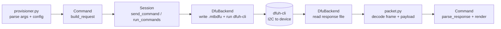

[Click here](../README.md) to view the README.

## Design and implementation

The host tool is a thin, layered CLI. Each provisioning operation is a self-contained sub-command; a small core turns a command's request bytes into a DFU transaction, drives Infineon's DFU Host Tool over I2C, and decodes the device's response. The design keeps three concerns strictly separated so the tool stays generic and extensible:

- **Protocol** — opcodes, status codes, framing, and field layouts live in one module and nowhere else.
- **Transport** — only one module knows the external `dfuh-cli` exists.
- **Commands** — each CLI verb is one file that declares its arguments and how to (de)serialize its payload; the core discovers it automatically.


## Project structure and modules

```
psc3-provisioning-host/
├── provisioner.py        # CLI entry point
├── config.yaml           # default settings (overridable by CLI flags)
├── requirements.txt
├── core/                 # protocol + transport + dispatch
│   ├── packet.py
│   ├── dfu_backend.py
│   ├── session.py
│   └── registry.py
├── commands/             # one module per CLI sub-command
│   ├── status.py  info.py  gen_key.py  read_pubkey.py
│   ├── get_csr.py  put_cert.py  get_cert.py  prove_cert.py
│   └── erase.py  finalize.py
└── _work/                # generated .mtbdfu requests and captured responses
```

**Table 1. Modules and their roles**

Module                  | Role
:---------------------- | :---
*provisioner.py*        | CLI entry point. Loads `config.yaml`, applies CLI overrides, asks the registry to discover commands, builds the `argparse` sub-command surface, constructs the backend/session, and dispatches the selected command.
*core/packet.py*        | The single source of protocol truth: the `Opcode`, `ProvStatus`, `SlotType`, and `AlgId` enumerations, the DFU framing and checksum helpers, the request builders (chunked-read request, subject-DN template) and the response parsers. No other module hard-codes a wire constant.
*core/dfu_backend.py*   | The only module that knows about `dfuh-cli`. Builds a `.mtbdfu` (JSON) request describing the DFU command sequence, runs `dfuh-cli --custom-command`, and returns the bytes captured from each response file. Provides a `--dry-run` preview that decodes frames without hardware.
*core/session.py*       | Per-transaction orchestration. Wraps single commands and multi-command (chunked) transactions, and implements the offset-based read/write loops (`read_blob`, `read_pubkey`) so command modules don't reimplement chunking. Also defines the `Context` handed to each command.
*core/registry.py*      | The `ProvCommand` base class, the `@register` decorator, and `discover()`, which imports every module under `commands/` so adding a command requires no core or CLI change.
*commands/\*.py*         | One module per CLI verb. Each subclasses `ProvCommand`, declares its `name`/`opcode`/arguments, and implements request/response (de)serialization (or overrides `run()` for a custom flow).


## How a command runs



For a simple, single-packet command the base class `ProvCommand.run()` performs the whole sequence: `build_request → Session.send_command → parse_response → render → exit code`. Commands that transfer a blob larger than one packet (CSR, certificate, public key) override `run()` and call the `Session` chunking helpers instead.


## How it works with the DFU Host Tool

The host never frames bytes onto the wire itself; it delegates that to `dfuh-cli`. The interaction is file-driven:

1. **Build the request.** For a transaction, `DfuBackend` writes a `.mtbdfu` JSON document into `_work/`. It contains an `APPInfo` block (file version, packet checksum type, Enter-DFU Product Id) and a `commands[]` array. Each entry carries:
   - `cmdId` — the provisioning opcode (e.g. `0x60`);
   - `dataLength` / `dataBytes` — the request payload, when present;
   - `outFile` / `outCli` — set when the response is to be captured;
   - `timeoutMS` — per-command response timeout (from `protocol.timeout_ms` / `--timeout-ms`), emitted when non-zero so slow on-device operations such as ML-DSA-87 keygen/sign are not aborted by the tool's short default.

2. **Invoke the tool.** `DfuBackend` runs:

   ```
   dfuh-cli --custom-command <file>.mtbdfu --hwid <id> --i2c-address 0x08 --i2c-speed <kHz>
   ```

   `dfuh-cli` opens the session (Enter DFU), frames and sends each `commands[]` entry as a DFU packet over I2C, receives the device response, and writes it to the named `outFile`.

3. **Capture the response.** With `outCli="true"` the tool writes a human-readable log containing the `Read packet:` line. `DfuBackend` reads that file and `packet.DfuResponse.from_capture()` extracts the response frame, validates the checksum, and exposes the provisioning payload (whose first byte is the result code).

4. **Sessions and transient state.** Some operations span several packets that must share one DFU session — for example a CSR is built in device secure RAM on the first chunk and discarded at Exit DFU. `Session.run_commands()` therefore emits all chunks as successive `commands[]` entries inside a single `.mtbdfu`, so they execute between one Enter/Exit-DFU pair. Single commands use `Session.send_command()`.

5. **Dry run.** With `--dry-run`, `DfuBackend` writes and prints the `.mtbdfu` and the decoded on-wire frames (SOP…EOP) but does not call `dfuh-cli`, so a flow can be developed and inspected without a board attached.

The framing, checksum, opcode, and per-command field layouts are specified in the device app's [Packet formats](../../psc3-provisioning-app/docs/packet_formats.md); `core/packet.py` is the host-side implementation of that specification.


## Configuration and dependencies

Runtime behaviour is driven by `config.yaml` (device address, I2C speed, checksum type, Product Id, per-command timeout, paths, and the `dfuh-cli` location), with every value overridable by a CLI flag. The only third-party dependencies are `PyYAML` (config parsing) and `cryptography` (used solely by `prove-cert` for X.509 parsing and signature verification — ECDSA-P256/P384/P521 and ML-DSA-87 — imported lazily). See [Using the host tool](using_the_host.md) for the full settings reference and command list, and [Adding commands](adding_commands.md) to extend the CLI.
